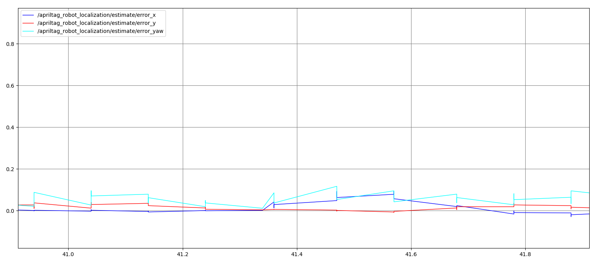
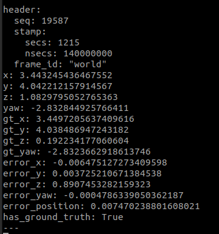
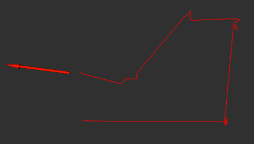
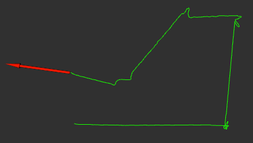

# lar_gazebo + AprilTag robot localization

Docker environment (ROS Noetic, Gazebo 11) that runs the
[lar_gazebo](https://github.com/lar-deeufba/lar_gazebo) simulation (branch `noetic`, LaR lab + Husky) and adds:

- an **AprilTag (tag36h11, id 0)** mounted on top of the Husky;
- a **fixed overhead camera** inserted into the simulation;
- **apriltag_ros** detecting the tag in the camera image;
- a node that computes the **robot pose in the `world` frame** from the detection, compares it with the
  Gazebo ground truth, and publishes the estimate, the errors and the trajectory (visualized in RViz).

The container is self-contained: the host only needs Docker. The host's Ubuntu/ROS version does not matter
(tested setup: Ubuntu 22.04 host with ROS 2 Humble installed, which is not used by this project).

[Simulation Demo](docs/lar_gazebo.gif)

## Requirements

- Linux host with an X11 session (Wayland works through XWayland)
- Docker Engine and the Docker Compose plugin

## Installation

```bash
# 1. Docker (Ubuntu 22.04)
sudo apt update
sudo apt install -y docker.io docker-compose-v2 x11-xserver-utils unzip
sudo usermod -aG docker $USER && newgrp docker      # or log out and back in
docker compose version

# 2. Project
unzip lar_gazebo_apriltag.zip
cd lar_gazebo_apriltag
chmod +x scripts/*.sh docker/entrypoint.sh lar_apriltag/scripts/*.py   # permissions are lost when unzipping

# 3. Build the image (the first build takes several minutes)
./scripts/build.sh
```

## Running

Launch Gazebo LaR lab simulation:
```bash
./scripts/sim.sh
```
Drive Husky with the keyboard:
```bash
./scripts/teleop.sh
```
To open a terminal inside the Docker environment:
```bash
./scripts/shell.sh
```

Launch arguments are passed straight to `roslaunch`:

```bash
./scripts/sim.sh cam_x:=6.7 cam_y:=4.4 cam_z:=3.0 cam_yaw:=1.5708 rviz:=false
```

## Inspecting the results

Run these inside `./scripts/shell.sh`.

```bash
rostopic echo /apriltag/tag_detections                       # raw detection (tag pose in the camera frame)
rostopic echo /apriltag_robot_localization/pose              # estimated robot pose (frame world)
rostopic echo /apriltag_robot_localization/estimate          # x, y, z, yaw + ground truth + errors
rqt_image_view                                               # /overhead_camera/image_raw, /apriltag/tag_detections_image
rqt_plot /apriltag_robot_localization/estimate/error_x /apriltag_robot_localization/estimate/error_y /apriltag_robot_localization/estimate/error_yaw
```


## Results

### Error plots

**Pose error (x, y, yaw)**



**Localization estimated topic**



**Estimated vs. real trajectory (world frame)**



